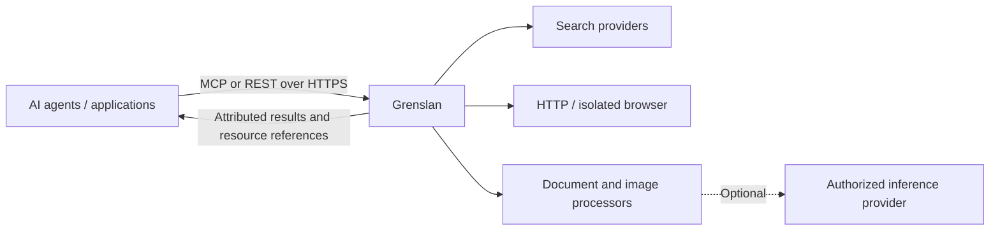

# Grenslan

**Open-source, self-hosted research infrastructure for AI agents and applications.**

Discover. Retrieve. Examine. Deliver.

Grenslan is a standalone, multi-user service designed to give AI agents, applications and other authorized clients access to search, information retrieval and document processing through secure Model Context Protocol (MCP) and REST interfaces.

Developed by RDF Industries, Inc., Grenslan takes its name from the Old Norse word for inquiry. It is an independent project, not an extension of any particular agent framework, model or knowledge platform.

## Project status

Grenslan is in pre-implementation development. The foundational v0.1 architecture is adopted as **Revision 12, Documentation Checkpoint 011**. The capabilities described below are the intended v0.1 scope, not a claim of currently implemented or tested functionality.

The next step is to finalize the public Tool Contract and Provider Contract schemas before implementation. Installation instructions, API examples and compatibility information will be added as the implementation becomes available and is validated.

## What Grenslan is designed to do

- **Search and discovery:** General web and image search, specialized scientific and technical search, configurable private repositories and deployment-specific data providers.
- **Content retrieval:** Direct HTTP retrieval and isolated browser-based rendering for dynamic pages, with bounded navigation and traversal.
- **Document and image processing:** Structured HTML extraction, text and data formats, PDFs, images, OCR, tables and Office documents, with explicit processing limitations.
- **Source provenance:** Preserve source attribution, capture information, content hashes and applicable page, section or region locators. Distinguish observed source content, search snippets and derived representations.
- **Artifact delivery:** Return relevant excerpts, metadata and authorized resource references so clients can inspect or retrieve large documents independently, without placing entire binary artifacts into a model's context.
- **Optional intelligence:** Support operator-configured inference for document interpretation, visual analysis, OCR or translation. Core research does not require a language model or GPU.

Search results are intended to preserve available provider attribution and ranking, with transparent relevance-based aggregation where applicable. Relevance is not evidence of factual reliability, and Grenslan does not apply a generalized source-trust or ideological ranking system.

## How it fits together

Grenslan is designed to work with QOR, Mnemosyne, Zygos and independently developed clients. None is a prerequisite. The consuming application retains responsibility for reasoning, orchestration, memory, knowledge indexing and long-term evidence retention.

Grenslan is not an autonomous research agent, an agent framework, a permanent research archive, a vector database or an authority that determines what a consumer should believe.

## Reference architecture

Python is the reference implementation language. The planned reference deployment is a primary Linux Docker container with an internal, separately managed SearXNG process. An operator may instead configure an existing authorized SearXNG instance.

| Area | Planned reference approach |
|---|---|
| General search | SearXNG |
| Specialized discovery | arXiv, Crossref, PubMed, OpenAlex and GitHub |
| Web retrieval | HTTPX and Playwright-controlled Chromium |
| Content processing | Replaceable, format-specific extraction, rendering and OCR providers |
| Consumer interfaces | Versioned MCP and REST; Python SDK and CLI as authorized clients |
| Execution | Bounded asynchronous I/O and isolated workers |
| Storage | Minimal internal persistence and bounded, expiring artifact cache |

The provider architecture is intended to support operator-authorized extensions without changing public research contracts. Alternative browsers, processing libraries and inference providers remain subject to compatibility, licensing and security validation.

The reference deployment targets Linux x86-64 and ARM64 containers, with Windows and macOS Docker environments subject to compatibility validation. Connected, restricted-network, internal-only and offline processing configurations are part of the baseline. Live public search requires connectivity to approved search providers.

## Security and privacy

Security and isolation are foundational requirements, not optional features to be added later.

- All consumer-facing MCP, REST and artifact-delivery network interfaces require HTTPS, including same-host and private-network deployments.
- MCP will use the current stable specification at implementation/release time, with Streamable HTTP over HTTPS and no legacy HTTP+SSE transport or insecure fallback.
- Authentication and authorization apply to each protected operation and resource access. Identical agent names in separate user or application contexts do not grant shared access.
- Browser and content-processing components must operate within constrained security and resource boundaries. Retrieved content cannot grant authority or change service configuration.
- Private data, credentials, sessions, cache entries and artifacts must remain isolated. Provider connectivity and disclosure are operator-controlled.
- No hosted AI service, external telemetry service, permanent corpus or centralized identity infrastructure is required for core operation.

Self-hosting does not imply that public web queries or retrieval requests remain within the local network. Operators configure and authorize outbound access according to their deployment policies.

## Development and documentation

The adopted architecture and active decision register define the v0.1 implementation baseline. They are intended to reside at `docs/ARCHITECTURE.md` and `docs/DECISION_REGISTER.md` in this repository. Earlier revisions are historical and do not impose additional implementation requirements.

The baseline defines 120 acceptance criteria. Conformance will be established through executed and recorded tests, including multi-user isolation, provider failures, artifact expiry and secure transport. No implementation or conformance test results are claimed at this stage.

## License

Original Grenslan code is licensed under the [Apache License, Version 2.0](LICENSE).

Third-party components retain their respective licenses. The bundled SearXNG component is licensed under AGPL-3.0-or-later and runs as a separate, confined process through its service interface. The repository contains no third-party binaries: `packaging/searxng/install.sh` fetches SearXNG's pinned source and hash-locked dependencies at install time. The [dependency inventory](docs/implementation/DEPENDENCIES.md) lists every component and the libraries compiled into its wheels, with their licences.

Source for the bundled components is published with each release on the [GitHub Releases page](https://github.com/RDFIndustries/grenslan/releases), next to the container image it belongs to, and stays available for as long as that image is offered. It covers SearXNG, every Python package and Rust crate in its environment, and every native library compiled into them. SearXNG is AGPL-3.0, and some of those libraries are LGPL (libidn2, libunistring, GNU libiconv). Their licences require that anyone who receives the binaries can obtain the corresponding source, and it also lets you audit, modify or rebuild any part. The container itself carries the licence texts and notices, and says where this source is. To assemble the same source set yourself, run `packaging/searxng/fetch-sources.sh OUTDIR`.

Before distributing a reference image or release, the project will publish applicable third-party license texts, copyright notices, component inventory and required corresponding-source information in both the repository and container. The README will link to those materials as they become available.

---

Copyright 2026 RDF Industries, Inc.
