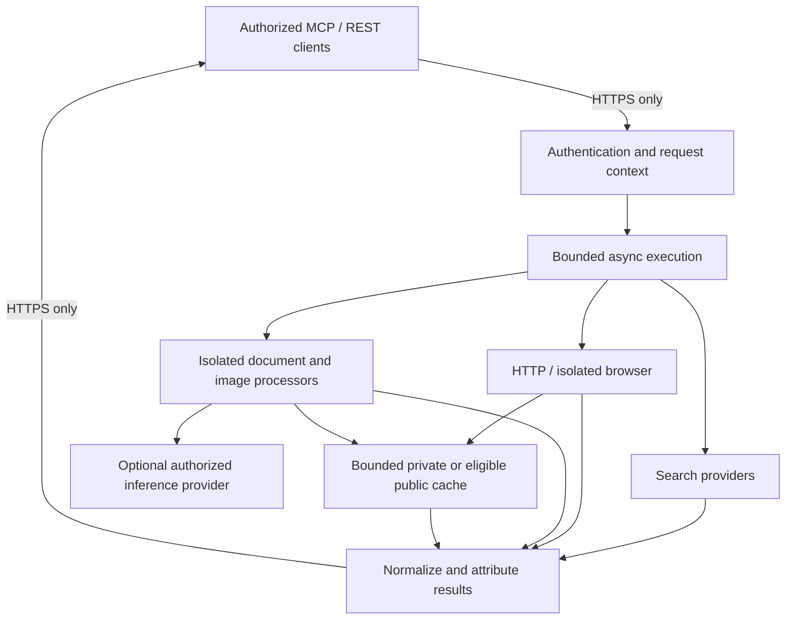

# Grenslan — Architecture Specification v0.1

| Attribute | Value |
|---|---|
| Project | Grenslan |
| Owner | RDF Industries, Inc. |
| Product version | 0.1 |
| Document revision | 12 |
| Documentation checkpoint | 011 |
| Date | 2026-11-25 (Pacific) |
| License | Apache-2.0 (original Grenslan code) |
| Status | Adopted foundational architecture through Round 10; project naming adopted |

## 1. Implementation authority

This document and `DECISION_REGISTER.md` are the current implementation baseline. Grenslan is the adopted name of the project formerly designated Agent Research Engine (ARE); see Section 18 and AD-433. Earlier revisions are historical and do not supply additional build requirements. `SCOPE_RECONCILIATION.md` is historical only. SHALL means required, SHOULD means recommended, MAY means optional. The decision register contains the normative requirements; the descriptions below explain their intended implementation. If an ambiguity is found, resolve it before implementation rather than importing a historical requirement. Tool/Provider Contract schemas and technology versions remain to be finalized.

## 2. Product and data flow

Grenslan is a tool, not a destination. It discovers and acquires information, prepares usable representations and delivers them to the originating authorized consumer. QOR, Mnemosyne, Zygos and third parties manage what happens afterward.



Normal search is request-local: receive query, call provider, normalize, return. No database write is required simply to return results. Opening a resource may create an expiring authorized reference for read/find/render/download. Consumer retains content and provenance if needed permanently.

## 3. Purpose and public contracts

MCP and REST are HTTPS-only ingress; SDK and CLI are authorized service clients. Use shared typed contracts and common authorization. FastAPI, Pydantic and MCP Python SDK are reference candidates, not pinned versions; pin the current stable MCP revision and compatible SDK at implementation/release. No legacy MCP compatibility or plaintext fallback. See Section 17. No hosted AI or consumer dependencies.

| Decision | Requirement |
|---|---|
| AD-365 | Independent research service |
| AD-366 | Consumer boundary |
| AD-367 | Interfaces and contracts |
| AD-368 | Tool discovery and composition |
| AD-369 | Optional intelligence |

## 4. Discovery and retrieval

SearXNG is bundled as a separately managed internal process in the reference container; an external instance is an optional replacement; initial specialized discovery adapters and customer-configurable government API extensions are specified in Section 15. Ordinary retrieval can use HTTPX before browser rendering when appropriate. Preserve provider ranking and allow requested filters; deterministic rank fusion is a candidate, not a mandate. Browser identity settings and alternative engines are operator controlled. External access restrictions remain enforceable.

| Decision | Requirement |
|---|---|
| AD-370 | Discovery providers |
| AD-371 | Search constraints |
| AD-372 | Ranking and aggregation |
| AD-373 | Duplicate handling |
| AD-374 | Retrieval routes |
| AD-375 | Browser provider and identity |
| AD-376 | Browser observation and interaction |
| AD-377 | Traversal and completeness |
| AD-378 | Retrieval failures and provider limits |
| AD-379 | Freshness and independent observations |

## 5. Content processing

Use Trafilatura and DOM parsers for HTML; evaluate hardened parsers, pypdf/pypdfium2, Pillow, restricted SVG, python-docx, openpyxl, python-pptx and OCR/layout tools. Candidates for complex PDF/visual handling include Docling, Marker, MinerU, Surya, PaddleOCR and Tesseract; validate code/weights licenses, accuracy and resource cost. OCR and rendering are important research capabilities; model-assisted interpretation is optional. Do not build a corpus index just to find text inside an open document. If compatible processing is unavailable or incomplete, offer the authorized original artifact with available provenance and explicit limitations (AD-420); the consumer handles remaining processing.

| Decision | Requirement |
|---|---|
| AD-380 | Normalized processing |
| AD-381 | Format baseline |
| AD-382 | HTML and structured content |
| AD-383 | Fidelity and limitations |
| AD-384 | Progressive document access |
| AD-385 | PDF and complex documents |
| AD-386 | Tables and technical material |
| AD-387 | Image and multimodal processing |
| AD-388 | Office fidelity |
| AD-389 | Safe processing and partial output |

## 6. Result provenance and delivery

Return source metadata, actual capture timestamps, extraction method, locators and declared expiry. Full documents and large artifacts default to resolvable authorized resource URIs with relevant available data, metadata, excerpts and attributed descriptions/summaries; original bytes are retrieved on demand rather than forced into model context. See Section 17. Hash the actual representation, not its URL. Store no mandatory claim graph or custody ledger. An expired artifact reference is not a permanent citation resolver. A consumer can save the delivered original and citation descriptor independently.

| Decision | Requirement |
|---|---|
| AD-390 | Result contract |
| AD-391 | Source and representation identities |
| AD-392 | Integrity and citations |
| AD-393 | Verification |
| AD-394 | Artifact delivery and expiry |
| AD-395 | Supplied and offline content |

## 7. Security and isolation

HTTPS is mandatory for all consumer-facing network communications, even on the same host or private network (AD-428). Authentication establishes application namespace; trusted client assertions identify user/agent/instance. Scope by context rather than agent name alone. Browser and parser workers are untrusted components. No unrestricted access to host, credentials, DB or unrelated resources. Network controls must cover actual connections and subrequests independent of page interception. A container alone is not a sandbox; host administrators retain privileged access.

| Decision | Requirement |
|---|---|
| AD-396 | Authentication and trusted context |
| AD-397 | Request isolation and object access |
| AD-398 | Credential handling |
| AD-399 | Browser isolation |
| AD-400 | Network and host protection |
| AD-401 | Transport and disclosure |
| AD-402 | Untrusted data and execution |
| AD-403 | Worker boundaries |
| AD-404 | Provider administration |
| AD-405 | Revocation and security outcomes |

## 8. Storage and execution

Keep active work in memory, with bounded async I/O and isolated worker pools. Internal PostgreSQL is the reference persistent backend when needed, not a mandatory write on every search. No pgvector or embedding pipeline, permanent corpus, durable job queue or research archive. Use restricted Unix socket and persistent configuration volume if database included; filesystem for expiring artifacts. Private cache by default; only eligible public content may be pooled. No hardcoded cache durations or concurrency values until measured.

| Decision | Requirement |
|---|---|
| AD-406 | Minimal internal persistence |
| AD-407 | Encapsulated database |
| AD-408 | Bounded cache |
| AD-409 | Cache consistency and cleanup |
| AD-410 | Concurrent request handling |
| AD-411 | Execution modes and results |
| AD-412 | Budgets and cancellation |
| AD-413 | Optional shared execution |
| AD-414 | Maintenance |

## 9. Packaging and conformance

A primary Grenslan Docker container encapsulates internal services. SearXNG is bundled as an internal separately managed process with a protected endpoint. An existing external SearXNG instance may replace it; optional host inference is explicitly authorized. See Section 16. If PostgreSQL is included, supervise initialization, readiness, graceful shutdown and persistent storage. Do not expose internal service ports. Apply security and isolation from first implementation milestone.

| Decision | Requirement |
|---|---|
| AD-415 | Reference deployment |
| AD-416 | Configuration and capability reporting |
| AD-417 | Integration and conformance |

## 10. Working tool inventory

Round 10 adopts the working inventory of 32 tools below. Names and exact schemas remain provisional until the Tool Contract. Do not expose unnecessary administrative tools to agents. Tool profiles are capability exposure, not authorization.

| Group | Candidate tools |
|---|---|
| Discovery | `web_search`, `image_search` |
| Web | `web_open`, `web_read`, `web_find`, `web_links`, `web_traverse` |
| Browser | `browser_session_create`, `browser_navigate`, `browser_observe`, `browser_interact`, `browser_screenshot`, `browser_session_close` |
| Documents | `document_open`, `document_inspect`, `document_read`, `document_find`, `document_tables`, `document_render`, `document_media` |
| Images | `image_open`, `image_inspect`, `image_transform`, `image_ocr` |
| Delivery and verification | `artifact_get`, `source_verify`, `quotation_verify`, `citation_get` |
| Support | `capabilities_get`, `operation_status`, `operation_results`, `operation_cancel` |

## 11. Result and state examples (illustrative, not contract schemas)

```json
{
  "schema_version": "1.0",
  "request_id": "req-001",
  "status": "completed",
  "results": [{"url": "https://example.org/paper", "title": "Example", "snippet": "Provider snippet", "provider": "searxng", "provider_rank": 1}],
  "limitations": []
}
```

```json
{
  "schema_version": "1.0",
  "request_id": "req-002",
  "status": "partial",
  "source": {"requested_url": "https://example.org/paper.pdf", "final_url": "https://example.org/paper.pdf", "retrieved_at": "2026-11-25T17:00:00Z", "method": "http", "cache_hit": false, "media_type": "application/pdf"},
  "content": {"format": "text", "text": "Extracted passage", "locator": {"page": 14}, "truncated": true},
  "artifacts": [{"uri": "grenslan://artifacts/resource-001", "media_type": "application/pdf", "size_bytes": 1824000, "sha256": "<actual digest>", "expires_at": "2026-11-26T17:00:00Z"}],
  "limitations": ["Remaining pages not processed"]
}
```

The version, URI scheme and values above are illustrative, not a final wire schema. The resource URI identifies the retained capture, not the original source URL; it grants no access by itself. MCP resource access or an authorized HTTPS artifact download resolves it without forcing the binary into model context.

Simple operation states: queued, running, completed, partial, failed, cancelled, timed_out, interrupted. Result availability is independent of execution state. Async references have bounded lifetime; reconnect behavior and expiry must be documented. No requirement for job restoration after restart.

| Data | Default handling |
|---|---|
| Credentials/configuration | Protected persistent state |
| Search requests/results | Request-local; return directly |
| Retrieved artifacts/representations | Temporary or bounded cache |
| Private browser state | Isolated, ephemeral; explicit bounded continuity if enabled |
| Async status/results | Bounded operation lifetime |
| Logs | Minimal, protected, bounded |
| Research history, embeddings, claims, memory | Consumer owned |

## 12. Implementation sequence

All milestones target v0.1, not separate releases. Security and isolation apply from the beginning.

1. Common contracts, HTTPS transport, authentication, trusted context, SearXNG and search normalization.
2. HTTP and browser retrieval, independent network enforcement, bounded execution and result routing.
3. HTML/structured extraction, progressive access, source attribution and artifact delivery.
4. PDF, images, OCR, tables, technical material and Office formats.
5. Expiring references, bounded cache, independent verification and optional document intelligence interfaces.
6. Docker packaging, operator configuration, MCP/API/SDK/CLI integration and conformance.

## 13. Remaining design work

Round 8 is adopted; see Section 15 for provider contracts and initial selections. Round 9 is adopted; see Section 16 for packaging, configuration and minimal storage implementation. Round 10 is adopted; see Section 17 for public contracts, integration, secure transport and foundational conformance. Project naming is complete (AD-433); the next activities are repository creation, README preparation and implementation-level specification before coding. Finalize Tool Contract and Provider Contract wire schemas and implementation-level specifications before coding; those details SHALL conform to the accepted baseline. No prior superseded requirement is automatically restored by these reviews. PostgreSQL inclusion, actual schema, cache defaults, worker isolation mechanisms, model/provider versions and performance limits require implementation-level validation. The reference database choice remains internal PostgreSQL if persistent database storage is used.

## 14. Acceptance criteria

All tests below are proposed conformance checks for the adopted baseline, not executed results. Expand into concrete fixtures and measurable limits during implementation. See the decision register for active requirements.

### Purpose and public contracts

- [ ] T-384: A clean installation executes search and deterministic extraction without a GPU, LLM, vector database or consumer framework.
- [ ] T-385: MCP, REST, SDK and CLI produce compatible authorized results; SDK/CLI cannot bypass service access.
- [ ] T-386: Capability discovery reports supported, disabled and unavailable tools; a bounded batch uses the same controls as an atomic request.
- [ ] T-387: Optional document intelligence unavailable: original and deterministic outputs remain obtainable.

### Discovery and retrieval

- [ ] T-388: SearXNG search normalizes titles, URLs, snippets, ranks and attribution; supported provider can be replaced.
- [ ] T-389: Category and filter tests distinguish native, locally applied, partly applied and unsupported constraints.
- [ ] T-390: Original provider ordering is available; deterministic aggregation preserves attribution and does not apply ideological or generalized source-trust scoring.
- [ ] T-391: Duplicate URLs and identical bytes are distinguished from syndicated or related sources; duplicates do not imply corroboration.
- [ ] T-392: Retrieve a static page using direct HTTP and a JavaScript-dependent page using Chromium/Playwright.
- [ ] T-393: Authorized alternate browser profile retains its configured identity for its lifetime without overriding network restrictions.
- [ ] T-394: Structured browser observations, links and screenshots are accessible; stale element handles fail.
- [ ] T-395: Read-only research authorization does not grant state-changing interactions.
- [ ] T-396: Traversal obeys visited-resource, depth, count and destination limits; incomplete rendering is identified.
- [ ] T-397: A provider outage, access challenge and genuine empty result produce distinct outcomes; retry/backoff and fallback remain bounded.
- [ ] T-398: Concurrent provider requests obey applicable shared rate limits and Retry-After.
- [ ] T-399: Cache hit, live capture, revalidation and offline access are distinguishable; independent retrieval bypasses incompatible cached/shared observations.

### Content processing

- [ ] T-400: Format matrix covers HTML, XHTML, text, Markdown, JSON, XML, PDF, PNG, JPEG, WebP, TIFF, GIF, SVG, CSV, TSV, DOCX, XLSX and PPTX; unsupported sub-capabilities are reported.
- [ ] T-401: HTML extraction preserves headings, links, code, lists and tables with source attribution.
- [ ] T-402: Mislabeled input is safely detected; malformed structured content reports failure.
- [ ] T-403: Extraction preserves original-language content; translation and model output are distinct attributed representations.
- [ ] T-404: Find exact passages, headings and neighboring text without an embedding provider; continuation respects output limits.
- [ ] T-405: Native PDF text, page locators, page/region rendering, columns, tables and scanned-page OCR are exercised on representative fixtures.
- [ ] T-406: Technical symbols, units and table cells are preserved or marked uncertain rather than invented.
- [ ] T-407: Image discovery, original retrieval, inspection, crop/thumbnail and OCR retain media type and origin.
- [ ] T-408: DOCX structure, XLSX cells/formulas/cached results and PPTX slide objects are returned with locators and applicable limitations.
- [ ] T-409: Macros, external data references, XML entities and embedded active content do not execute or initiate unauthorized network access.
- [ ] T-410: Oversized images, decompression expansion, recursion, memory and duration limits are enforced; partial successful output is labeled.

### Result provenance and delivery

- [ ] T-411: Search snippets are not labeled as captured content; retrieval reports requested/final URL, capture time, method, media type and cache status.
- [ ] T-412: Two live observations remain distinct even if original bytes match; changed representations do not overwrite a prior reference.
- [ ] T-413: SHA-256 matches independently computed artifact digest; corruption and missing artifacts are explicit.
- [ ] T-414: Citation locator resolves the matching page/section/region while available; expired reference returns explicit unavailable status.
- [ ] T-415: Quotation verification distinguishes exact match, mismatch and unavailable content; integrity does not claim truth.
- [ ] T-416: A fresh independent verification returns attributable observation and limitations; contradictory content is not silently suppressed.
- [ ] T-417: Large binary artifact streams or reference-based retrieval remain authorized and avoid forced model-context delivery.
- [ ] T-418: Authorized imported document is processed offline and labeled supplied content; arbitrary host path is denied.

### Security and isolation

- [ ] T-419: Unauthenticated requests are denied; forged application claims cannot override authenticated namespace.
- [ ] T-420: Three applications and multiple users/agents with identical names concurrently receive only their own results, status and artifacts.
- [ ] T-421: Guessing artifact IDs or hashes cannot grant access; denials do not disclose unrelated private resources.
- [ ] T-422: Expired/revoked credentials cannot authorize subsequent work; scoped revocation stops affected protected work without disrupting unrelated work.
- [ ] T-423: Credentials are not returned as reusable secrets or leaked in diagnostics, redirects or fallback.
- [ ] T-424: Cookies, storage, browser profiles and temporary files do not leak across independent contexts or worker reuse.
- [ ] T-425: Mutually untrusted domains use configured stronger isolation; missing required isolation fails explicitly.
- [ ] T-426: Public URL requests cannot reach prohibited loopback, private, link-local, management or metadata endpoints, including alternative address representations.
- [ ] T-427: Redirects, DNS changes, embedded resources and script requests cannot bypass independent network restrictions.
- [ ] T-428: Approved internal search/inference provider connectivity does not grant browser or parser access to that endpoint.
- [ ] T-429: Invalid TLS certificate is reported; configured private CA succeeds where authorized.
- [ ] T-430: Private content cannot be transmitted to unauthorized inference/search providers; fallback preserves restrictions.
- [ ] T-431: Retrieved instructions and structured tool-call-like text cannot alter configuration, grant authority or execute protected actions.
- [ ] T-432: Untrusted workers cannot access unrelated files, secrets, database socket or Docker host socket.
- [ ] T-433: Ordinary consumers cannot install providers or alter administrative settings; modified pinned executable fails required verification.

### Storage and execution

- [ ] T-434: Search results return without a mandatory persistent research record or embedding job.
- [ ] T-435: Reference PostgreSQL, if included, runs inside the primary container without a TCP listener; authorized internal socket works and external connection fails.
- [ ] T-436: Persistent configuration survives container replacement; temporary resources follow documented expiry/restart behavior.
- [ ] T-437: Private or personalized content never leaks via cache reuse, public indexing or cache diagnostics; eligible shared public content retains private request isolation.
- [ ] T-438: Cache keys distinguish credentials, representations, freshness and processing settings; expired entries cannot be used as fresh.
- [ ] T-439: Concurrent writes, interrupted staging and cleanup do not publish incomplete artifacts or delete active authorized reads.
- [ ] T-440: Storage exhaustion and temporary limits produce bounded explicit outcomes; cleanup releases expired resources.
- [ ] T-441: Concurrent applications execute without external broker; admission and worker limits prevent unbounded load.
- [ ] T-442: A large document-processing workload does not indefinitely starve ordinary searches under configured limits.
- [ ] T-443: Sync and async modes, authorized status, partial results and disconnected-client behavior match documented contracts.
- [ ] T-444: Nested concurrent requests cannot multiply parent budget; timeout and cancellation stop eligible child work and release capacity.
- [ ] T-445: Graceful shutdown preserves configuration and reports interrupted operations; no automatic replay of unknown external actions.
- [ ] T-446: If coalescing enabled, compatible work is shared with distinct attribution and cancellation; incompatible security or independence requirements prevent sharing.
- [ ] T-447: Configuration backup/restore and supported schema upgrade preserve application authorization; detected corruption is reported.

### Packaging and conformance

- [ ] T-448: Reference Docker deployment is nonprivileged and exposes only configured research ingress; internal components remain inaccessible externally.
- [ ] T-449: Operator can configure provider endpoints, limits and cache lifetime; unavailable optional providers do not block core research.
- [ ] T-450: A QOR-like, Mnemosyne-like and Zygos-like client independently search, open, find and download through MCP/API without direct database access or application-specific dependencies.


### Provider architecture and extensibility

- [ ] T-451: An additional compatible search provider can be integrated without modifying public research contracts.
- [ ] T-452: Provider capability declarations identify supported and unsupported requested operations.
- [ ] T-453: Direct HTTP and browser retrieval can be selected through consistent interfaces.
- [ ] T-454: Standard Chromium and an approved alternative browser can use the common browser contract.
- [ ] T-455: A selected PDF page or region can be processed without unnecessarily processing the entire document where supported.
- [ ] T-456: Complex document-processing failures preserve available original artifacts and report extraction limitations.
- [ ] T-457: Optional host inference can be disabled without disabling deterministic retrieval and processing.
- [ ] T-458: Provider fallback cannot expand network access or disclose another consumer’s information.
- [ ] T-459: An ordinary research request cannot install or activate an unapproved executable extension.
- [ ] T-460: Distributed reference dependencies and model weights have documented license, version and integrity information.
- [ ] T-461: Initial specialized discovery providers (arXiv, Crossref, PubMed, OpenAlex and GitHub) return normalized attributable results through the common interface; an operator can add a deployment-specific government API provider without modifying public contracts, and no fixed government endpoint is required.
- [ ] T-462: Brave Origin operates through the approved browser-provider interface while maintaining applicable isolation and network restrictions; validate compatibility before enabling or distributing it.
- [ ] T-463: When compatible document processing is unavailable, Grenslan can deliver the authorized original artifact with available provenance and explicit processing limitations, without asserting uninspected contents.
- [ ] T-464: Operators can configure and replace authorized inference endpoints without modifying Grenslan’s core implementation.

## 15. Provider architecture and extensibility (Round 8 adopted)

Providers are ordinary typed Python adapters, not mandatory services or autonomous agents. Use capability-specific versioned interfaces (`SearchProvider`, `RetrievalProvider`, `BrowserProvider`, `ContentProcessor`, `OCRProvider`, `IntelligenceProvider`). Keep browser engine and controller separable. Contracts declare configured capabilities, categories, filters and limitations; pass request identifier, deadline, resource scope, limits, cancellation and approved credential reference only as needed. Keep provider registration operator-controlled; no marketplace, executable auto-download or distributed plugin framework is required. The detailed schemas remain for contract specification.

### 15.1 Discovery

| Provider | v0.1 selection |
|---|---|
| SearXNG | Primary general discovery and initial development/test provider; bundled internal process by default; external instance optional |
| arXiv | Initial direct scientific/technical preprint adapter |
| Crossref | Initial publication and DOI adapter |
| PubMed | Initial medical and biological discovery adapter |
| OpenAlex | Initial scholarly discovery adapter |
| GitHub | Initial software and technical discovery adapter |
| Government data APIs | Customer-added, deployment-specific providers; no fixed mandatory endpoints or jurisdictions |
| Private document repositories | Configurable provider support; specific connectors selected per deployment |
| Commercial search APIs | Optional operator-configured integrations |

Each provider is independently configurable and disableable. Customers can implement or configure a government API adapter through the documented provider interface; a new API may require adapter code for its authentication, query, pagination and response schema. Adding a provider does not imply arbitrary network access or automatic executable installation. The operator authorizes endpoints, credential scope and disclosure. Preserve provider attribution, original ordering and supported filters. Deterministic relevance aggregation (RRF is a candidate) may combine results; no generalized source-trust ranking, embeddings or LLM reranking required.

### 15.2 Retrieval and processing selections

| Component | Selection |
|---|---|
| Direct HTTP | HTTPX reference |
| Browser controller | Playwright reference |
| Browser engine | Chromium reference |
| Alternative browser | Clearcote Open, initial alternative subject to validation |
| Alternative browser | Brave Origin, initial alternative subject to validation |
| HTML | Trafilatura reference; lxml recommended for DOM and restricted parsing |
| Text, Markdown, JSON, CSV/TSV | Native Python processing |
| XML | Restricted lxml or defusedxml candidate |
| PDF inspection and text | pypdf recommended |
| PDF rendering | pypdfium2 recommended |
| Complex PDF/layout | Docling initial candidate |
| OCR | Tesseract recommended |
| Images | Pillow recommended; restricted SVG rendering |
| Office | python-docx, openpyxl, python-pptx recommended |

Firefox is not an initial target. Validate alternative browsers for Playwright compatibility, headless behavior, sandboxing, license and redistribution before enabling or shipping. Do not select a licensed Clearcote distribution automatically. Prefer direct HTTP for static resources; escalate to browser for requested rendering or dynamic content, not to circumvent access restrictions. Preserve session-consistent identity profiles and private browser state.

Select native text, layout analysis, page/region rendering or OCR according to resource characteristics and requested output. Process selected portions when supported. Optional visual interpretation remains separate from original and deterministic representations. Evaluate code, transitive dependencies, binaries and model-weight licenses before distribution. If no compatible processor is available, processing fails, or a budget is exceeded, provide the authorized original document via inline, streamed or expiring reference delivery as appropriate, with available provenance, partial results and limitations. Do not claim search metadata proves the presence of an uninspected passage. The consuming agent handles remaining processing. No license-incompatible processing package is required simply to deliver the original. This fallback does not waive the supported-format capabilities where compatible implementations exist or bypass security and delivery limits.

### 15.3 Optional inference configuration

Support native Ollama and OpenAI-compatible adapter types, targeting Ollama, vLLM, llama.cpp and other compatible or custom services. Configure endpoint, model, supported capabilities, credentials reference where applicable, deadlines and concurrency through operator settings. Multiple endpoints may be configured or inference disabled. Example (illustrative only):

```yaml
intelligence:
  enabled: false
  default_provider: local_vision
  providers:
    local_vision:
      type: ollama
      endpoint: http://host.docker.internal:11434
      model: operator-selected-model
      capabilities: [vision, document_interpretation]
    alternate_vision:
      type: openai_compatible
      endpoint: http://inference-server:8000/v1
      model: operator-selected-model
      capabilities: [vision, document_interpretation]
  timeout_seconds: 120
  max_concurrent_requests: 2
```

The endpoint addresses, model capabilities and numerical settings are illustrative and must be validated in the deployment. Explicit endpoint authorization is scoped to the provider component; it does not allow untrusted workers to reach host services. Apply disclosure restrictions to submitted content. Do not bundle inference engines or model weights merely to enable research; no embedding pipeline or cognitive retrieval is introduced.

### 15.4 Active provider decisions

| Decision | Requirement |
|---|---|
| AD-418 | Minimal provider contracts |
| AD-419 | Reference provider selection |
| AD-420 | Selective content processing and original-artifact fallback |
| AD-421 | Provider execution boundaries |
| AD-422 | Provider configuration and distribution |

## 16. Deployment, distribution and configuration (Round 9 adopted)

### 16.1 Reference installation

Distribute one primary Linux Docker image containing Grenslan, SearXNG as a separately supervised internal process, required browser and compatible document-processing components, and PostgreSQL only if persistent database requirements justify inclusion. SearXNG communicates through a protected internal endpoint using its service interface, not by incorporating its source into Grenslan modules. Prefer restricted local sockets where supported; any internal TCP endpoint must be inaccessible to external consumers and untrusted workers. Bind and isolate endpoints explicitly; loopback alone is not a security boundary between processes in a container. Configure upstream search engines individually. SearXNG is a metasearch engine: live public search sends queries and applicable parameters to upstream engines, which can observe the installation's egress IP. No central SearXNG account, hosted service, mandatory telemetry or remote licensing is required for core functionality. Validate outbound traffic of the selected build; do not claim zero outbound connections. Do not pass unrelated agent context to upstream engines.

An existing operator-authorized SearXNG instance MAY replace the bundled process. Compose MAY be supplied as convenience, not a prerequisite or a separate mandatory search service. Optional host inference remains configurable. Native Python installation is a development/testing option; Kubernetes and distributed clusters are not required. Consumers connect via authenticated MCP/REST over HTTPS only; SDK/CLI are clients. Local-only deployment defaults to restricted host ingress and SHALL still use HTTPS. Grenslan serves TLS directly in the reference container; an approved reverse proxy is optional only if no plaintext consumer-facing interface or network hop is introduced. See AD-428 and Section 17.

### 16.2 Platforms and resources

Target Linux x86-64 and ARM64, including DGX Spark and Jetson as validation targets. Windows Docker Desktop/WSL2 and macOS Docker are supported targets subject to compatibility validation. Document actual browser and processor availability by architecture; alternative browsers are not universally mandatory. CPU-capable core research is required; optional external inference may use customer hardware. No GPU runtime is required inside Grenslan.

### 16.3 Minimal state

Configuration and protected credential references persist; active requests, ordinary search results and bounded async status can remain in memory. Use isolated temporary directories and bounded filesystem caching with expiring authorized references. Determine whether persistent metadata is needed after implementing retrieval, artifact access and cache behavior. If PostgreSQL is justified, run it inside the primary container using restricted Unix-domain socket access, no TCP listener, protected volumes and supervised startup/shutdown. Do not introduce a mandatory intermediate SQLite database, durable job queue or permanent corpus. Restart invalidates unrecoverable references explicitly. Suggested internal paths: `/etc/grenslan/config.yaml`, `/var/lib/grenslan/cache`, `/var/lib/grenslan/state`, `/run/grenslan`; actual paths and resource limits remain implementation choices.

### 16.4 Operator configuration

Use a validated versioned YAML configuration with environment overrides and protected secret references. Validate before admission; report unknown/invalid fields without secret leakage. Missing optional providers degrade only affected capabilities; invalid mandatory configuration fails explicitly. Controlled restart is sufficient; live reload optional. TLS certificates and keys are mounted/protected and replaceable without rebuilding the image; invalid mandatory TLS configuration prevents service admission. No administration dashboard or distributed configuration service is required. Customer-added government APIs and other providers use approved installed adapters or supported configuration-based integrations; no arbitrary executable downloads from research requests.

Illustrative configuration (not a final schema or production defaults):

```yaml
server:
  bind: 0.0.0.0
  port: 8443
  tls:
    certificate_file: /run/secrets/grenslan_tls_cert.pem
    private_key_file: /run/secrets/grenslan_tls_key.pem
    minimum_version: "1.2"
authentication:
  required: true
  applications:
    qor:
      credential_file: /run/secrets/qor_api_key
      trusted_context: true
search:
  default_provider: searxng
  providers:
    searxng:
      mode: bundled
      upstream_engines: [operator-selected-engine]
    arxiv:
      enabled: true
    crossref:
      enabled: true
    pubmed:
      enabled: true
    openalex:
      enabled: true
    github:
      enabled: true
browser:
  default: chromium
  max_concurrent_sessions: 4
intelligence:
  enabled: false
cache:
  max_size_gib: 5
  artifact_lifetime_seconds: 3600
  share_eligible_public_content: false
limits:
  max_concurrent_requests: 20
  request_timeout_seconds: 120
logging:
  log_queries: false
  log_content: false
```

Use approved endpoint and credential configuration for optional external SearXNG, inference and customer APIs. Numerical values and names are illustrative; validate hardware, secrets and endpoint behavior. The bind example is inside the container, not a recommendation to publish the port to all host interfaces.

### 16.5 Deployment protection and profiles

Use nonprivileged container operation, restricted mounts and capabilities, no Docker socket, no required host networking, read-only root filesystem where compatible, validated browser sandbox and restricted worker identities. Apply independent egress enforcement to actual connections and subrequests; trusted adapters' approved internal endpoints must not become reachable to browser or document workers. Container networking alone does not establish process-specific isolation; validate a suitable enforcement mechanism without disabling browser sandboxing to make it work. Default to denying unintended host/private/management destinations. Support connected, restricted-network, internal-only and offline processing profiles. Offline public search is unavailable; supplied artifacts and authorized internal sources remain usable. Offline installation must include approved dependencies without mandatory startup downloads.

### 16.6 Release, licensing and maintenance

Distribute source, versioned container images and exportable image archives for offline use. Provide Dockerfile, optional Compose example, configuration example, dependency inventory and integrity information, install/upgrade/rollback instructions, platform limitations and licensing notices. Updates are operator initiated, not automatic executable downloads during research.

Original Grenslan code remains Apache-2.0. SearXNG is AGPL-3.0 and separately executes through its service interface; this does not eliminate applicable obligations. Review actual selected dependency and binary/model licenses, including transitive components and corresponding-source requirements, before distribution. Provide applicable license texts, copyright notices and source availability information in the image and repository, not just links. Suggested container documentation path: `/usr/share/doc/grenslan/` with `LICENSE`, `THIRD_PARTY_NOTICES.md`, component inventory and `licenses/`. Repository contains equivalent license materials and notices; README summarizes original and bundled licensing and links to detailed notices and source information. Generate inventory during build where practical. README and GitHub repository creation remain outstanding; naming has been adopted under AD-433. README and installation/Tool Contract documentation SHALL identify the supported MCP revision, HTTPS-only endpoints, certificate trust setup, and absence of legacy transport compatibility.

Provide lightweight liveness, readiness, capability and basic resource reporting, bounded protected logs, cache expiry and graceful shutdown. Optional provider failure must not unnecessarily disable core operations. External metrics, persistent audit database and dashboard are not required.

### 16.7 Active deployment decisions

| Decision | Requirement |
|---|---|
| AD-423 | Reference distribution and installation |
| AD-424 | Platform portability |
| AD-425 | Operator configuration |
| AD-426 | Connected and restricted deployment compatibility |
| AD-427 | Controlled release and maintenance |

### 16.8 Deployment acceptance criteria

- [ ] T-465: Grenslan can be installed as a standalone Docker container with bundled SearXNG or configured to use an existing authorized SearXNG endpoint.
- [ ] T-466: The single-container reference deployment supports ordinary search without mandatory separate SearXNG, Docker Compose or inference infrastructure.
- [ ] T-467: Reference Linux x86-64 deployment passes core functional and isolation tests.
- [ ] T-468: Reference Linux ARM64 deployment passes core functional and isolation tests.
- [ ] T-469: Supported Windows and macOS Docker environments can execute core research operations; provider limitations are reported.
- [ ] T-470: Invalid configuration produces explicit validation outcomes without exposing secrets.
- [ ] T-471: Customer-added API providers can be installed and configured without changing public research contracts.
- [ ] T-472: Untrusted browser workers cannot inherit authorized internal search or inference endpoint privileges.
- [ ] T-473: Restricted-network configurations deny unauthorized destinations while allowing approved research destinations.
- [ ] T-474: Offline installations process supplied documents without requiring external connectivity.
- [ ] T-475: Optional provider failure does not unnecessarily prevent ordinary research execution.
- [ ] T-476: Reference release packages include applicable dependency, licensing and deployment information; the README links to detailed notices and applicable source information.
- [ ] T-477: Bundled SearXNG operates internally without requiring a separate container or hosted SearXNG instance.
- [ ] T-478: Internal SearXNG is inaccessible through unauthorized external connections and untrusted execution workers.
- [ ] T-479: Network inspection confirms outbound SearXNG traffic conforms to configured provider and disclosure policies.
- [ ] T-480: Distributed container and repository include applicable licenses, notices and required source-code availability information.


## 17. Public tool contracts, integration and foundational conformance (Round 10 adopted)

### 17.1 Protocol and secure consumer transport

Use the current stable MCP specification at implementation/release and record its exact revision and compatible SDK version. The reference network transport is MCP Streamable HTTP over HTTPS; the official transport name is Streamable HTTP, even when secured by TLS. Do not implement the deprecated HTTP+SSE transport or legacy compatibility fallback. SSE framing within the pinned modern transport, where applicable, remains permissible over HTTPS. Follow the pinned specification for protocol negotiation, unsupported revision errors, required headers and authorization. Apply required Origin validation and host/DNS-rebinding protections. Do not rely on an MCP session identifier as authentication or authorization. No persistent MCP session database is required.

HTTPS is mandatory for every consumer-facing network interface: MCP, REST and binary artifact delivery. No loopback, same-machine, Docker-network or private-LAN exception. TLS 1.2 minimum; prefer TLS 1.3. Support public and enterprise/private CA certificates and locally generated certificates explicitly trusted by the client. Grenslan-provided clients validate certificate identity, validity and trust and reject invalid/untrusted certificates without plaintext fallback. Configure TLS through deployment settings and protected mounted files. Certificate replacement must not require rebuilding the container; a controlled restart is sufficient. Mutual TLS is optional. Direct TLS in the single primary container is the reference deployment; no external proxy, CA management service or public CA is required. An approved reverse proxy may be used only while preserving encryption of consumer-facing network communication and preventing access to bypass endpoints. Internal in-process/Unix-socket IPC and authorized outbound HTTP web retrieval are not prohibited by this client-ingress requirement; previously accepted egress restrictions remain in effect.

Illustrative endpoints: `https://grenslan.example.internal:8443/mcp`, `https://grenslan.example.internal:8443/api/v1/...`. Names, route paths, and port are provisional. Any optional local stdio forwarding client is only a client of the secured Grenslan service, not a separate unprotected research ingress.

### 17.2 Tool composition and profiles

The inventory in Section 10 is the working set. `web_search` supports categories and applicable provider selection (including specialized academic/news/technical/government sources); `web_open` can accept a single URL or bounded batch, rather than requiring a separate batch tool. `document_open` accepts an authorized supplied file or retrieves a document, `document_inspect` exposes available structure, `document_read` selects pages/sections/sheets/slides, and rendering permits selected regions. `image_transform` supports bounded crops, resize and thumbnails. Browser session operations preserve context and authorization.

Basic profile: web_search, web_open, web_read, web_find, image_search, artifact_get. Technical profile additionally exposes document and verification tools; advanced profile includes explicit browser interaction; full profile exposes enabled and authorized tools. Operators may configure profiles; visibility never grants authority. Capability discovery reports enabled, disabled, unavailable and unsupported functions. A deterministic composition such as web_search with `retrieve: {max_sources: 3, representation: "text"}` may discover a larger bounded result set and retrieve only the requested number. Preserve discovery and retrieval attribution independently and enforce shared budgets. Names and parameters are illustrative pending exact schema definition.

### 17.3 Results, artifact references and continuation

Versioned typed results carry request ID, execution outcome, payload and limitations. Discovery snippets and actual captures remain distinct. Large documents/PDFs and other large resources default to a resolvable resource URI plus available decision-useful information (relevant excerpts with page/section locators, source URL, title, authors, dates, source-provided abstract or description, available table of contents, media type, size, integrity hash, expiry and provenance). Derived summaries are optional, attributed and distinguished from source-provided descriptions; no mandatory inference or invented content. If compatible processing is unavailable, return available discovery metadata and limitations without claiming uninspected passages, with the authorized original reference if safely acquired and deliverable.

The consumer decides whether to inspect, import or discard the resource. No automatic context insertion of full binaries. MCP resource reads and authorized HTTPS artifact delivery provide exact retained original bytes when available, independently of derived text or images. The opaque URI is not a bearer credential; enforce authorization on every resolution, including expiry and integrity checks. Declare unavailable or expired originals explicitly. Where bounded inline data is appropriate, support text and multimodal representations for capable clients, with continuation and attribution; mark omitted content and estimates. No silent summarization. Final URI and wire schemas remain to be defined.

### 17.4 Authentication, operation and errors

Application credentials and standards-compatible MCP authorization enforce the same research and object boundaries. Where configured for interoperable MCP authorization, use the applicable external authorization-server integration under the pinned specification; Grenslan need not implement an enterprise identity provider. Trusted application context may identify user, agent and instance within its authenticated namespace, never another namespace. Enforce authorization for all protected operations, references, artifact resolution, status, results and cancellation. Names and IDs alone establish no authority.

Synchronous is the default; explicit bounded async operations return an authorized reference for status/results/cancellation. Restart may report interruption or unavailability; no durable recovery is required. Structured errors distinguish invalid_request, unauthorized, unsupported_capability, provider_unavailable, rate_limited, access_restricted, network_error, retrieval_failed, extraction_failed, resource_limit, timeout, artifact_expired, integrity_error, cancelled and interrupted (illustrative names). Transport/protocol errors follow applicable standards. Partial failures are distinct from successful empty results. No independent enterprise governance, agent runtime, cognitive retrieval or durable research archive is introduced.

### 17.5 Active public interface decisions

| Decision | Requirement |
|---|---|
| AD-428 | Public interfaces and secure transport |
| AD-429 | Practical tool composition and profiles |
| AD-430 | Consumer-aware result and artifact delivery |
| AD-431 | Consumer authentication and interoperability |
| AD-432 | Final foundational implementation boundary |

### 17.6 Round 10 acceptance criteria

- [ ] T-481: A supported MCP client can discover and invoke research tools using Streamable HTTP over HTTPS.
- [ ] T-482: MCP and REST provide equivalent research capabilities under equivalent authorization and request conditions.
- [ ] T-483: Python SDK and CLI operate through authorized public service interfaces.
- [ ] T-484: Configured tool profiles expose appropriate research capabilities without bypassing authorization.
- [ ] T-485: A bounded search-and-retrieve request returns discovery results and attributable retrieved content.
- [ ] T-486: Unsupported search constraints are explicitly reported.
- [ ] T-487: Large original artifacts can be retrieved without inserting their binary contents into model context.
- [ ] T-488: Native image-capable and text-oriented clients receive appropriate representations.
- [ ] T-489: Output limits and continuation preserve source attribution and identify omitted content.
- [ ] T-490: Expired or unauthorized artifact references cannot disclose protected content.
- [ ] T-491: Supported MCP authorization and trusted application credentials enforce the same applicable research boundaries.
- [ ] T-492: Concurrent users with identically named agents receive only authorized results.
- [ ] T-493: Structured partial failures remain distinguishable from successful empty results.
- [ ] T-494: Reference deployment performs ordinary research without cognitive memory, vector indexing, durable workflows or optional inference.
- [ ] T-495: A third-party consuming application can integrate using documented public contracts without RDF Industries product dependencies.
- [ ] T-496: Grenslan implements its documented current MCP specification and explicitly reports unsupported protocol versions.
- [ ] T-497: Large documents return resolvable resource URIs, available metadata and relevant content without mandatory inline binary delivery.
- [ ] T-498: Consumers can independently inspect, import or disregard returned resources, with authorization and integrity preserved.
- [ ] T-499: MCP, REST and artifact delivery endpoints operate exclusively over HTTPS, including same-host and private-network deployments.
- [ ] T-500: Plaintext HTTP requests and deprecated MCP transport requests cannot invoke Grenslan capabilities or retrieve protected resources.
- [ ] T-501: Grenslan operates successfully using both publicly trusted and privately trusted TLS certificates.
- [ ] T-502: Grenslan-provided clients reject invalid or untrusted server certificates and never fall back to insecure communication.
- [ ] T-503: Deployment certificates can be replaced without rebuilding the Grenslan container.

## 18. Project identity and naming

Grenslan is the adopted public product name, superseding the working designation Agent Research Engine (ARE). The name is an Old Norse word for inquiry or investigation, chosen for ease of spelling and pronunciation, distinctive identity and alignment with the service's purpose.

| Attribute | Adopted identity |
|---|---|
| Public product name | Grenslan |
| Canonical technical identifier | `grenslan` |
| Owner | RDF Industries, Inc. |
| Intended GitHub repository | `RDFIndustries/grenslan` |
| Product descriptor | Open-source, self-hosted research infrastructure for AI agents and applications |

Grenslan remains independent of QOR, Mnemosyne, Zygos and all other consuming applications. The rename applies to project documentation and project-owned technical naming examples; it does not alter interface semantics, licensing, provider selection, security requirements, existing decision IDs or acceptance criteria. Wire schemas, routes, URI formats and deployment paths remain provisional where previously identified as such. The intended repository is not a claim of repository creation, registry reservation, domain ownership or trademark clearance; these are not prerequisites to this naming adoption.

| Decision | Requirement |
|---|---|
| AD-433 | Project identity and naming |

No additional implementation acceptance criterion is introduced by the naming decision. Documentation consistency is checked editorially, not counted as an executed runtime acceptance test.

## 19. Documentation checkpoint 011

Round 10 remains adopted with current MCP compatibility only, URI-first large-artifact delivery and mandatory HTTPS for all consumer-facing network interfaces. The foundational architectural review is closed; all active implementation requirements target v0.1. The project naming review is complete and Grenslan is adopted under AD-433. Revision 12 supersedes Revision 11 (Checkpoint 010) as the implementation baseline; no functional, security, transport or deployment requirements are changed by the rename. Historical IDs remain reserved, not implementation requirements. Acceptance criteria remain unexecuted until implementation and recorded validation.

| Item | Count or identifier |
|---|---|
| Active accepted decisions | 69 (AD-365–433) |
| Pending architectural decisions | 0 |
| Active acceptance criteria | 120 (T-384–503) |
| Executed acceptance tests | 0 |
| Next decision | AD-434 |
| Next test | T-504 |
| Next activity | Create the Grenslan repository and README; finalize implementation-level contracts before coding |
